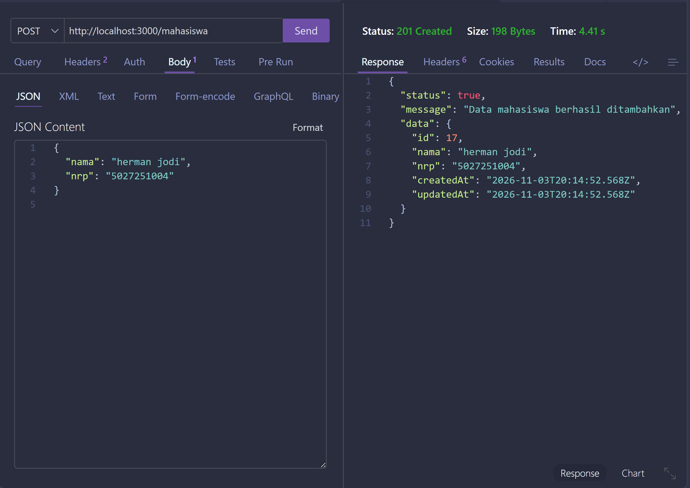
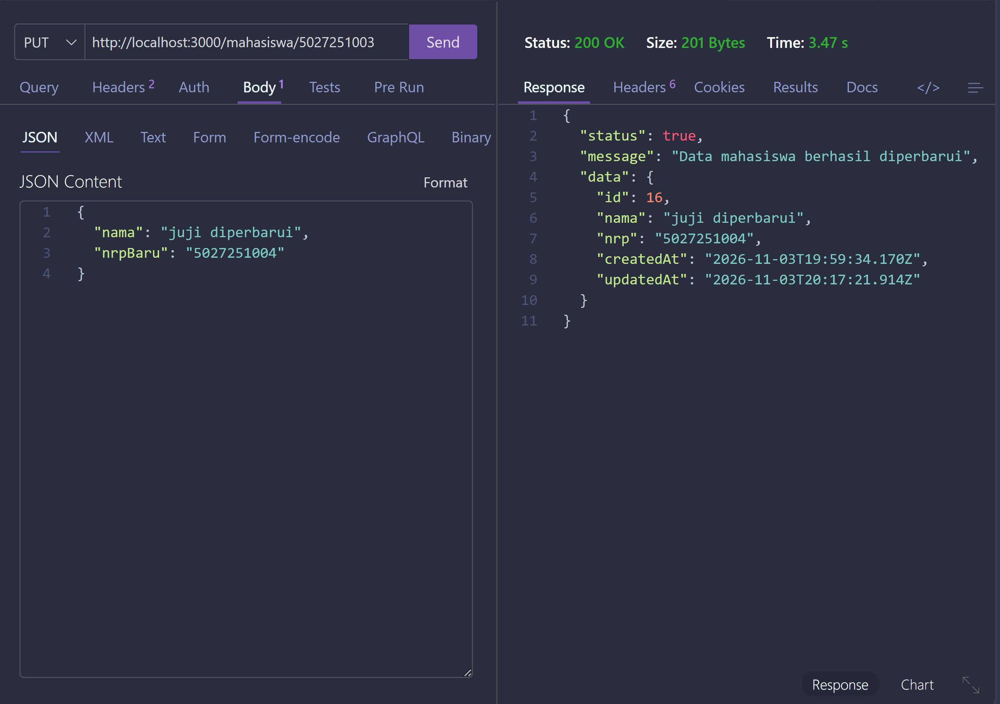
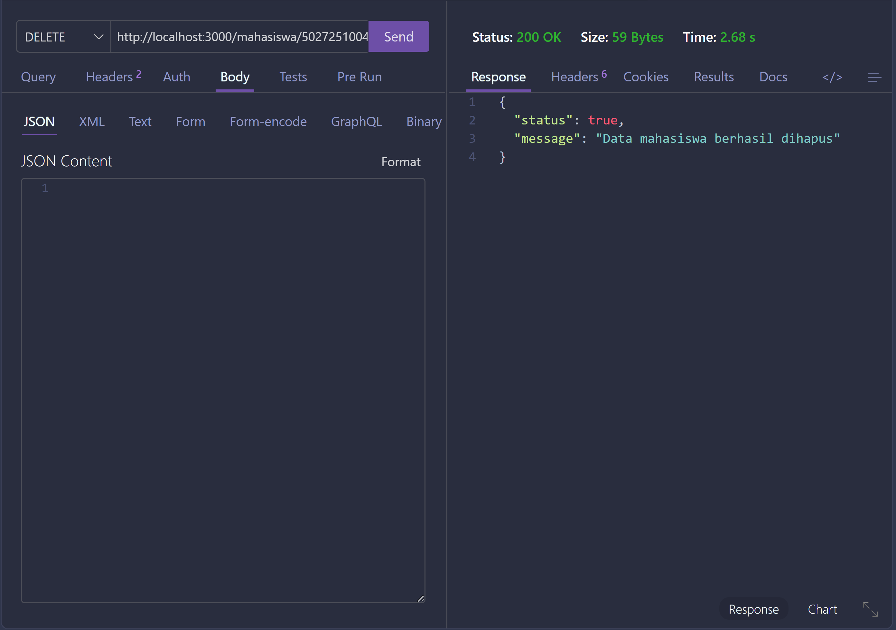

# Class Activity Week 9-10 - Manajemen Data Mahasiswa

## Tampilan aplikasi

## Contoh penggunaan API

### Menambahkan mahasiswa

### Mengubah data mahasiswa

### Menghapus mahasiswa

## Endpoint API

Semua endpoint menggunakan prefix `/mahasiswa`.

| Method | Endpoint | Fungsi |
| --- | --- | --- |
| `GET` | `/mahasiswa` | Mengambil semua data mahasiswa |
| `GET` | `/mahasiswa/:nrp` | Mengambil data berdasarkan NRP |
| `POST` | `/mahasiswa` | Menambahkan mahasiswa |
| `PATCH` | `/mahasiswa/:nrp` | Memperbarui data mahasiswa |
| `PUT` | `/mahasiswa/:nrp` | Memperbarui data mahasiswa |
| `DELETE` | `/mahasiswa/:nrp` | Menghapus data mahasiswa |
| `GET` | `/health` | Memeriksa koneksi server dan database |
